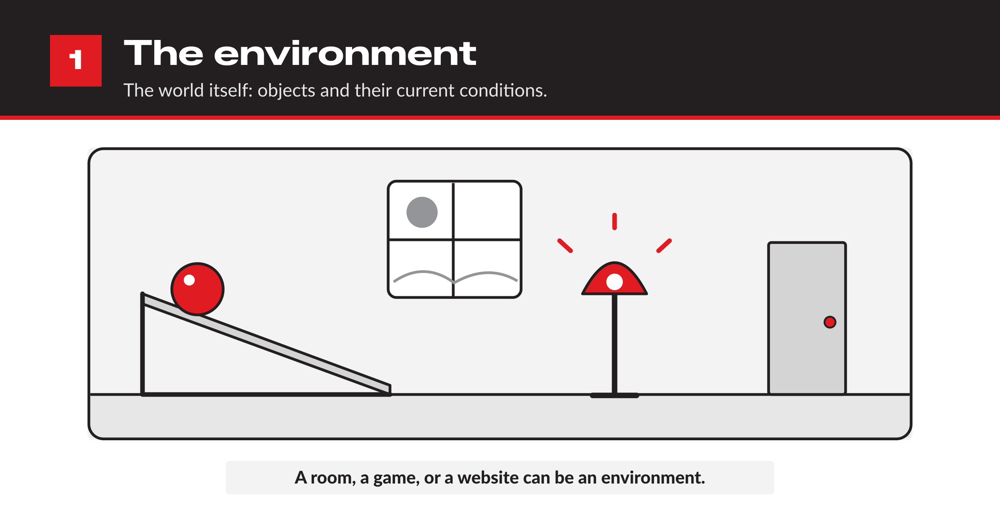
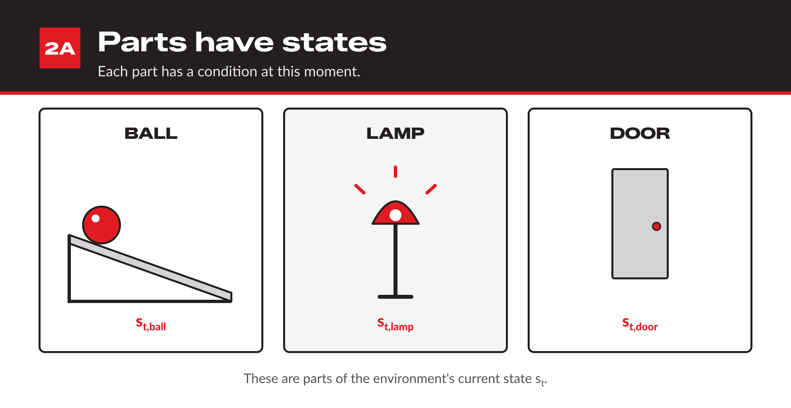
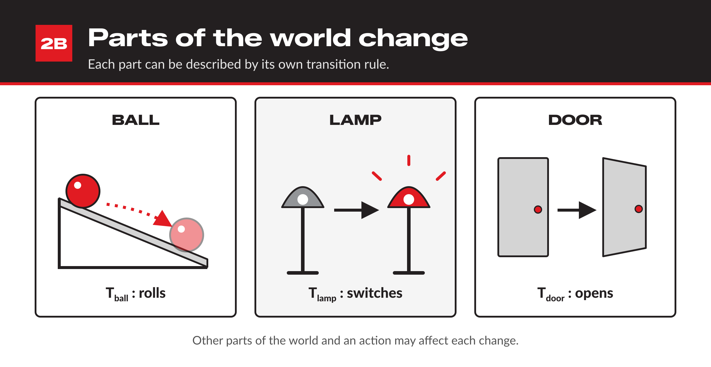
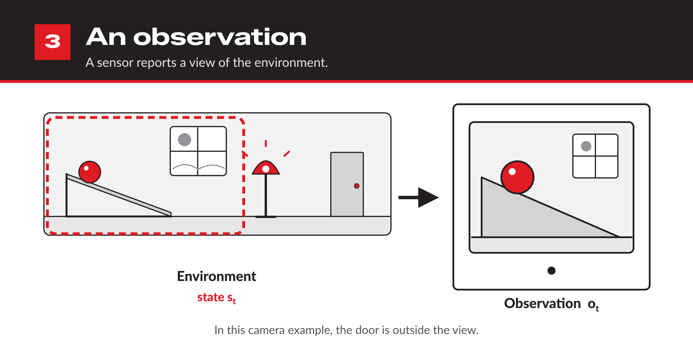
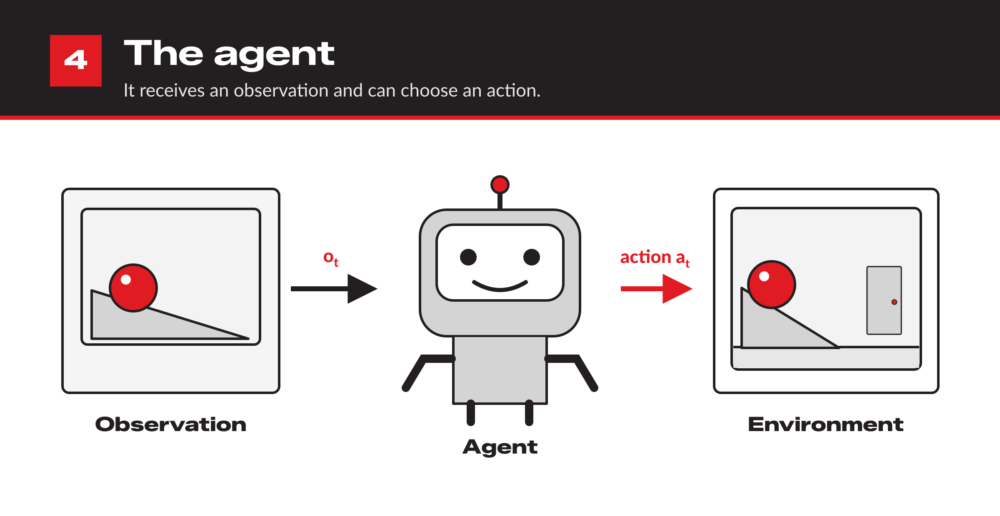

# What Counts as a World Model? Definition, Evidence, and a Target-Based Taxonomy

## Abstract

A growing range of systems are called world models, from latent dynamics used for planning to video generators and scene representations. Their different prediction interfaces make the label difficult to apply consistently. This survey proposes an operational boundary: a world model learns a reusable relation for predicting how an environment changes, from available context and, when claimed, actions or interventions. We distinguish that membership claim from evidence that the relation is accurate, generalizes, or supports control. After defining the environment and agent interface, we specify tests for those claims and organize methods primarily by prediction target, with modality and application as separate axes. Static scene inference is discussed as an adjacent case rather than treated as demonstrated dynamics.

## 1. Introduction

The term *world model* now covers systems that predict future pixels, latent features, physical variables, rewards, or textual changes. Some can be queried under candidate actions; others learn from passive observations. [Ha and Schmidhuber's World Models](https://arxiv.org/abs/1803.10122) combines compressed visual representation with temporal dynamics, whereas [MuZero](https://arxiv.org/abs/1911.08265) learns dynamics for planning without reconstructing the next observation. More recent action-conditioned video and feature models extend the range of outputs and applications. These systems share an interest in predicting environmental consequences, but the phrase *world model* alone does not say which consequences they can predict or how well.

The literature is active, and existing surveys already organize parts of it by predicted representation, embodiment, and application (see [survey-overlap.md](survey-overlap.md)). We argue that the field still needs a consistent way to connect the name *world model* to a predictive interface and the evidence for it across domains. Our contribution is therefore a **proposed operational definition and evidence framework**, followed by a cross-domain synthesis, rather than a claim that target-based classification is new. We ask three questions of each system: **What environmental relation is modeled? What evidence shows that its predictions track the environment? Which modality and application delimit that evidence?** This framing separates an author's name for a system from the capabilities its experiments establish.

We first describe an environment relative to an agent and distinguish observed state from hidden state. We then define the predictive interface that counts as a world model for this survey and identify adjacent static or purely reactive systems. Next, we specify how to evaluate the claimed relation at the appropriate horizon and under relevant changes. Finally, we classify prediction targets and map them to input and output modalities and current uses, including robotics, games, driving, web interaction, and generation. The examples in this draft are representative; the corpus and selection protocol for a systematic survey remain to be specified.

## 2. Environment and agent boundary

An **environment** is what lies outside the agent's chosen boundary and can produce observations; when the task includes interaction, it can also change and produce outcomes in response to actions. It may be physical, simulated, or digital. What counts as environment depends on the interface: for a robot, the room and manipulated objects may be outside the boundary; for a game agent, the game engine is the environment. The agent may observe a sufficient state, only a partial view, or a history from which the state must be inferred.

*Figure 1a. The environment is the world being interacted with. The room is one example; a game or website can also be an environment.*

*Figure 1b. A snapshot of the environment has state $s_t$. The illustrated ball, lamp, and door each have a current condition $s_{t,j}$.*

Here $j$ names an illustrated part: $s_{t,\mathrm{ball}}$ records the ball's current condition, and likewise for the lamp and door. These are selected components of the full state $s_t$.

*Figure 1c. The matching $T_j$ labels name how each part can change. The rules may depend on the rest of the environment and on an action.*

Let $T(s_{t+1}\mid s_t,a_t)$ denote the environment's transition rule: how its state may change after action $a_t$. For passive tasks, omit the action. In the illustration, $T_j(s_{t+1,j}\mid s_t,a_t)$ describes the change of part $j$ given the full current state and action. The parts may influence one another; their updates need not be independent. These are descriptions of the environment, not learned world-model predictions or a requirement to represent objects separately.

*Figure 1d. The room has state $s_t$; the camera produces observation $o_t$ through the observation rule $\Omega$. This camera reveals only part of the environment; another interface may reveal all state information needed for prediction.*

*Figure 1e. The agent receives observation $o_t$ and can choose action $a_t$. The robot represents a decision-making agent, which may also be software. Passive tasks can omit the action.*

Let $\Omega(o_t\mid s_t)$ denote how an observation arises from the current environment state. The agent may receive a nearly complete description or only a partial view. When one observation is insufficient, it can use the history $h_t=(o_{\le t},a_{<t})$ of observations and past actions; include observed rewards if they reveal additional state information. Neither seeing the state nor observing a long history means the agent knows the transition rule $T$. A learned world model attempts to predict relevant consequences from the information available through this interface.

## 3. An operational definition and its boundary

We use **environment modeling** for the broad task of learning relations among variables generated by an environment. Within that scope, we call a learned system a **world model** when it exposes a predictive relation from an available state or observation history to an *outcome at a later time*, with the conditioning variables needed for its stated task. The outcome may be an observation, measured state, geometry, learned representation, or decision-relevant signal. The relation may be deterministic or probabilistic, one step or multi-step, decoded or latent. An action interface is necessary for a claim about action consequences, but not for passive forecasting. This is a survey convention for comparing systems, not a universal definition attributed to the cited authors.

Formally, let $h_t$ be the available interaction history and $y_{t+k}^{(y)}$ the target outcome at horizon $k>0$. A schematic world-model query is

$$
\hat y_{t+k}^{(y)}\sim p_\theta\!\left(\cdot\mid h_t,a_{t:t+k-1}\right),
$$

where $p_\theta$ is a learned conditional distribution and $a_{t:t+k-1}$ is the action sequence from time $t$ through $t+k-1$. In a passive setting, omit the action sequence. The symbol $y$ is a placeholder for the declared prediction target; a deterministic predictor can be written $\hat y_{t+k}^{(y)}=g_\phi(h_t,a_{t:t+k-1})$. Neither expression requires access to the true state, a pixel decoder, or a reward. It also does not certify that predictions are accurate under unexecuted actions.

### 3.1 Included dynamics, with different kinds of fidelity

A direct state model might approximate $p_\theta(s_{t+1},r_{t+1}\mid s_t,a_t)$. A model of partial observations may instead encode history as $z_t=f_\theta(h_t)$ and predict a future observation, latent, or reward from $z_t$ and $a_t$. The representation $z_t$ need not reconstruct $o_t$ or equal $s_t$. For example, [MuZero](https://arxiv.org/abs/1911.08265) learns iterated latent dynamics to predict reward, value, and policy quantities relevant to search, while [DreamerV3](https://arxiv.org/abs/2301.04104) imagines future scenarios with a learned environment model. These are world models under the proposed definition, although their fidelity is assessed against different targets. A future-feature predictor such as [V-JEPA 2-AC](https://arxiv.org/abs/2506.09985) also enters the temporal category; the JEPA architecture itself does not determine whether a task is temporal.

### 3.2 Adjacent systems and exclusions

**Structural inference** predicts unavailable content at a fixed time: a masked region, an occluded surface, or a novel view. It can be useful to build a world model, but its objective alone does not demonstrate change over time. In [I-JEPA](https://arxiv.org/abs/2301.08243), for example, $z_t^{(c)}$ denotes context features, $z_t^{(y)}$ target-region features, and $\ell_t$ target locations within the same image. Its schematic prediction is

$$
\hat z_t^{(y)}=g_\phi(z_t^{(c)},\ell_t)\approx z_t^{(y)}.
$$

The shared time index is the boundary: this relation does not by itself predict $t+1$. We therefore include same-time scene and feature methods as **adjacent structural models** in the taxonomy, and do not count them as established temporal world models unless they add a temporal predictive interface. Conversely, a reactive policy that maps the current observation directly to an action, a classifier of present observations, or a language model shown only to predict text tokens does not meet our boundary merely because it may contain useful knowledge. A policy can *use* a world model, and token prediction can *implement* one, when the system has an identifiable environmental outcome interface. This boundary concerns the demonstrated function, not the backbone or the name used in a paper.

## 4. What evidence supports a world-model claim?

The first question is **membership**: does the system learn and expose a temporally indexed prediction of an environmental outcome? The second is **quality**: how closely does that prediction track the environment within the claimed scope? To substantiate a world-model claim empirically, we require at least a declared future target and a comparison between predictions and held-out environmental outcomes at that target. Without such a comparison, the system is a candidate world model with an unverified predictive claim. A model may meet the definition and still be inaccurate. Conversely, success on a downstream task alone does not identify which environmental relation was learned.

We propose reporting five complementary forms of evidence. The applicable tests depend on the claimed interface; no single scalar score certifies a general world model.

| Claim to test | Minimum evidence to report | What it does not establish alone |
| --- | --- | --- |
| **Target fidelity** | Compare predicted and observed outcomes on held-out transitions, using a metric appropriate to the declared target and a simple baseline. | One-step fit does not establish useful rollouts or physical understanding. |
| **Temporal consistency** | Evaluate multiple horizons or unrolled predictions, including compounding error and stable constraints where relevant. | A plausible long video may still miss task-critical state changes. |
| **Action or intervention sensitivity** | For a controllable model, compare outcomes of executed alternative actions or controlled interventions from comparable contexts; report action coverage. | Conditioning on action tokens alone does not establish counterfactual accuracy. |
| **Generalization and uncertainty** | Test held-out configurations, objects, rules, or domains within a stated scope; report uncertainty or failure rates where the interface permits. | Transfer outside the test distribution remains unverified. |
| **Decision utility** | When planning or control is claimed, compare decisions made with and without the learned model under the same protocol. | Better task reward does not prove every predicted variable is correct. |

Controlled tests should change one relevant factor while holding others as steady as possible, then compare the model response with the observed outcome. Complementary controls vary irrelevant factors to test whether the purported relation survives those changes. [WorldBench](https://arxiv.org/abs/2601.21282) illustrates concept-specific evaluation for physical video models; its results also caution against treating visual plausibility as sufficient evidence of physical consistency. For text or web environments, interventions and outcomes may be page actions and textual state changes rather than physical forces. Report the predicted target, test conditions, horizon, and downstream performance separately. These tests support claims within the sampled environments; they do not establish a complete causal account of reality.

## 5. Taxonomy by prediction target, modality, and application

The categories overlap: a system with several predicted quantities can occupy several rows. **Prediction target is the primary axis**; input/output modality and application are additional axes. Horizon, action conditioning, architecture, and use also cut across target classes. Same-time structural rows are retained to make the boundary visible, not to reclassify them as temporal world models. The equations are survey sketches of modeled quantities, not the cited papers' exact objectives; diffusion and flow methods may train on noise or velocity while generating a future observation.

A model-level account of the challenge each method addresses, its approach, and remaining limits is in [model-comparison.md](model-comparison.md).

| Target | Approximation | Representative models and distinguishing idea |
| --- | --- | --- |
| **Structured state** | $p_\theta(s_{t+1}\mid s_t,a_t)$ | [PETS](https://arxiv.org/abs/1805.12114) uses an uncertainty-aware dynamics ensemble over supplied state variables. [Chreode](https://arxiv.org/abs/2605.28111) predicts one-step cell-state changes under biological interventions. |
| **Observations or visual tokens** | $p_\theta(o_{t+1:t+H}\mid h_t,a_{t:t+H-1})$, with actions omitted for passive prediction | [IRIS](https://arxiv.org/abs/2209.00588) autoregressively predicts compressed visual tokens. [Genie](https://arxiv.org/abs/2402.15391) infers latent actions from unlabeled video to control generated worlds. [DIAMOND](https://arxiv.org/abs/2405.12399) trains an agent inside a diffusion game model. [GameNGen](https://arxiv.org/abs/2408.14837) generates action-conditioned Doom frames. [GAIA-1](https://arxiv.org/abs/2309.17080) predicts driving-video tokens from video, text, and actions. [Cosmos-Predict2.5](https://arxiv.org/abs/2511.00062) uses flow-based generation for text-, image-, and video-conditioned simulation. |
| **Reconstructive latent state** | $p_\theta(z_{t+1}\mid z_t,a_t)$ and $p_\theta(o_t\mid z_t)$ | [DreamerV3](https://arxiv.org/abs/2301.04104) combines imagined latent transitions with observation, reward, and continuation prediction. |
| **Learned target features** | $\hat z_{t+k}^{(y)}\approx z_{t+k}^{(y)}$, with $k=0$ or $k>0$ | [I-JEPA](https://arxiv.org/abs/2301.08243) predicts masked features within one image ($k=0$), making it a structural representation-learning boundary case rather than a temporal dynamics model. [DINO-world](https://arxiv.org/abs/2507.19468) predicts future frozen DINOv2 patch features from video, then adds action conditioning for planning. [V-JEPA 2-AC](https://arxiv.org/abs/2506.09985) predicts future video features conditioned on robot actions. [LeWorldModel](https://arxiv.org/abs/2603.19312) learns next-feature prediction end to end without an EMA teacher; [Fast-LeWM](https://arxiv.org/abs/2606.26217) extends it to parallel action-prefix horizons. |
| **Decision-relevant signals** | $\hat r_{t+1}$, $\hat v_{t+k}$, or $\hat\pi_{t+k}$ along learned transitions | [MuZero](https://www.nature.com/articles/s41586-020-03051-4) trains a latent transition through reward, value, and policy targets rather than observation reconstruction. [TD-MPC2](https://arxiv.org/html/2310.16828v2) also matches next latents while learning reward and value. |
| **Explicit 3D geometry** | $\hat g_{t+1}=F_\theta(g_t,a_t)$ | [3D Point World Models](https://arxiv.org/abs/2607.00148) completes occluded point clouds before predicting action-conditioned 3D dynamics. |
| **Scene structure or novel views (adjacent structural case)** | $p_\theta(o_t^{(y)},g_t\mid o_t^{(c)},c_t)$, where $c_t$ specifies a view | [Atlas](https://www.worldlabs.ai/blog/atlas) generates camera-controlled views and explicit 3D output from multimodal scene context. This row captures its spatial tasks; the company also reports space-time simulation. Its public description is not a full methods paper. |
| **World and actions jointly** | $p_\theta(y_{t+1:t+H},a_{t:t+H-1}\mid h_t,\text{goal})$, with $y$ visual or latent | [DreamZero](https://arxiv.org/abs/2602.15922) adapts video diffusion for joint video/action prediction. [$\tau_0$-WM](https://arxiv.org/abs/2606.01027) also simulates candidate actions and predicts task progress. [LeWAM (Fu et al.)](https://arxiv.org/abs/2610.12818) combines next-latent prediction with action flow matching. |
| **Textual state changes** | $p_\theta(\Delta o_{t+1}^{(\mathrm{text})}\mid h_t,a_t)$, where $\Delta o_{t+1}^{(\mathrm{text})}$ describes the change | [WMA](https://arxiv.org/abs/2410.13232) predicts important browser-page changes in natural language after a proposed action. |

[Genie 4](https://deepmind.google/blog/genie-4-a-new-generation-of-world-simulation/) is publicly described as an interactive audiovisual simulator, but its exact learning objective is not disclosed in the cited announcement.

### 5.1 Modality: what the model receives and predicts

Modality describes the form of the evidence and output, not the learned relation by itself. We record input and output separately: an image-conditioned model can predict geometry, and a language-conditioned model can predict video. A visual-token model still belongs in the observation target class when the tokens encode future frames.

| Modality or representation | Typical input → predicted outcome | Illustrative cases |
| --- | --- | --- |
| **Structured variables** | Measured state and actions → later state or reward | [PETS](https://arxiv.org/abs/1805.12114); [Chreode](https://arxiv.org/abs/2605.28111) for cellular states and interventions. |
| **Images and video** | Frames, sometimes actions or text → later frames or visual tokens | [GameNGen](https://arxiv.org/abs/2408.14837); [GAIA-1](https://arxiv.org/abs/2309.17080). |
| **Learned visual features** | Images or video → future latent features | [V-JEPA 2-AC](https://arxiv.org/abs/2506.09985); [LeWorldModel](https://arxiv.org/abs/2603.19312). |
| **Geometry and spatial data** | Point clouds or scene context → later geometry; same-time views belong to the adjacent structural class | [3D Point World Models](https://arxiv.org/abs/2607.00148); [Atlas](https://www.worldlabs.ai/blog/atlas) for the structural case. |
| **Text and interface state** | Browser history and proposed action → textual description of a later change | [WMA](https://arxiv.org/abs/2410.13232). |

### 5.2 Application: where the predictive relation is used

Applications determine what counts as an intervention, a valid outcome, and a consequential error. **Generation** is a use of a predictive model, rather than a single observation modality or environment; it can occur in games, video, robotics, and driving. The table records current examples, not exclusive assignments.

| Application or use | Representative predictive question | Examples and evaluation emphasis |
| --- | --- | --- |
| **Robotics and embodied control** | What state, image, or feature follows this action? | [V-JEPA 2-AC](https://arxiv.org/abs/2506.09985), [DreamZero](https://arxiv.org/abs/2602.15922); test action grounding, physical interaction, and task success. |
| **Games and interactive simulation** | What happens after the player's or agent's next move? | [MuZero](https://arxiv.org/abs/1911.08265), [DIAMOND](https://arxiv.org/abs/2405.12399), [GameNGen](https://arxiv.org/abs/2408.14837); test rollout consistency and whether imagined play improves decisions. |
| **Driving** | How will the scene evolve under an ego action or route? | [GAIA-1](https://arxiv.org/abs/2309.17080); test scene evolution, other-agent behavior, and safety-relevant outcomes. |
| **Web and software interaction** | How will an interface change after a proposed action? | [WMA](https://arxiv.org/abs/2410.13232); test whether predicted page changes match executed actions. |
| **Scientific and biological forecasting** | How does a measured system change under time or intervention? | [Chreode](https://arxiv.org/abs/2605.28111); test held-out transitions and interventions in the measured domain. |
| **Video and environment generation** | Can the model generate a coherent future from context and controls? | [Genie](https://arxiv.org/abs/2402.15391), [Cosmos-Predict2.5](https://arxiv.org/abs/2511.00062); test temporal, control, and relevant physical consistency in addition to visual quality. |

## 6. Variations within target classes

The predicted quantity is the primary axis, but methods with the same target can differ substantially. LeWM follow-ups illustrate five secondary axes: [Fast-LeWM](https://arxiv.org/abs/2606.26217) changes the **prediction horizon** through action prefixes; [ALeWM](https://arxiv.org/abs/2609.32921) changes **latent capacity**; [AC-MTM](https://arxiv.org/abs/2608.17542) changes the **anti-collapse signal** through contrastive inverse dynamics; [Traj-LeWM](https://arxiv.org/abs/2608.14125) changes the **planning criterion** by scoring the path; and [LeWAM](https://arxiv.org/abs/2610.12818) adds **action generation**. A separate [LeWAM paper](https://arxiv.org/abs/2610.12407) independently uses the same acronym for a related world-action architecture. These distinctions need not create new target classes.

These examples do not all descend from LeWM. An [independent LeWM reproduction](https://arxiv.org/abs/2608.10145) finds that preprocessing and evaluation choices materially change planning results, underscoring the need to report protocols alongside targets.

## 7. Synthesis

The distinction is **which future consequences a model is asked to preserve**. Observation prediction retains visual detail; feature prediction retains information selected by an encoder; decision-focused prediction retains information useful for reward and planning. These impose different accuracy tests. Our operational boundary requires a learned temporal prediction about the environment, while the evidence framework asks how far that prediction holds under longer horizons, changed conditions, and interventions. A cross-domain comparison should therefore report the target, conditioning, modality, application, and tested scope together before making a broader world-model claim.
